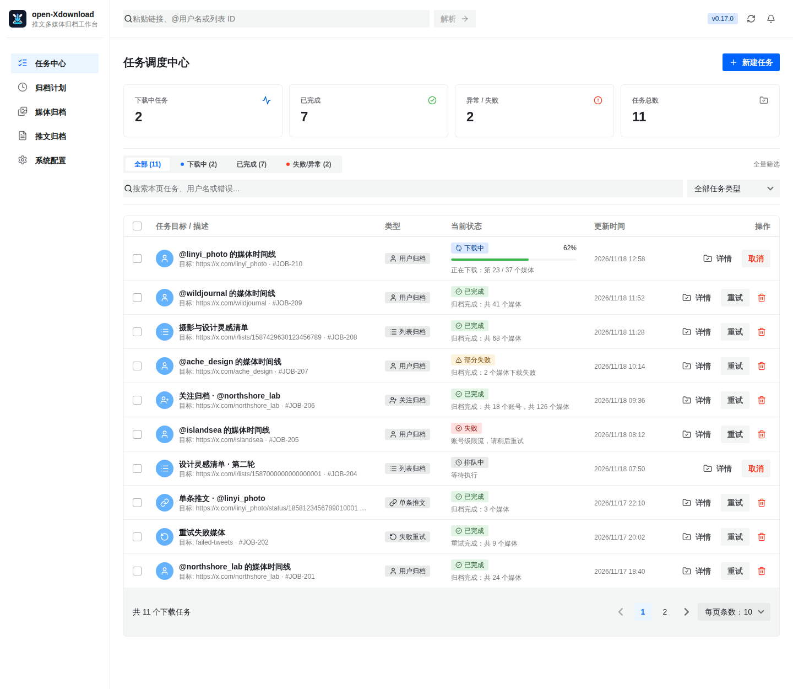
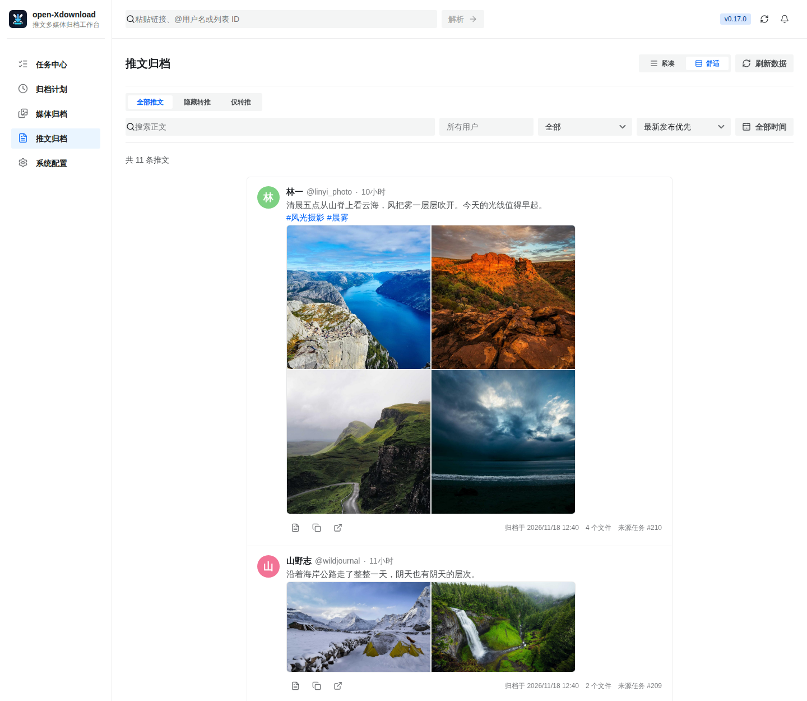
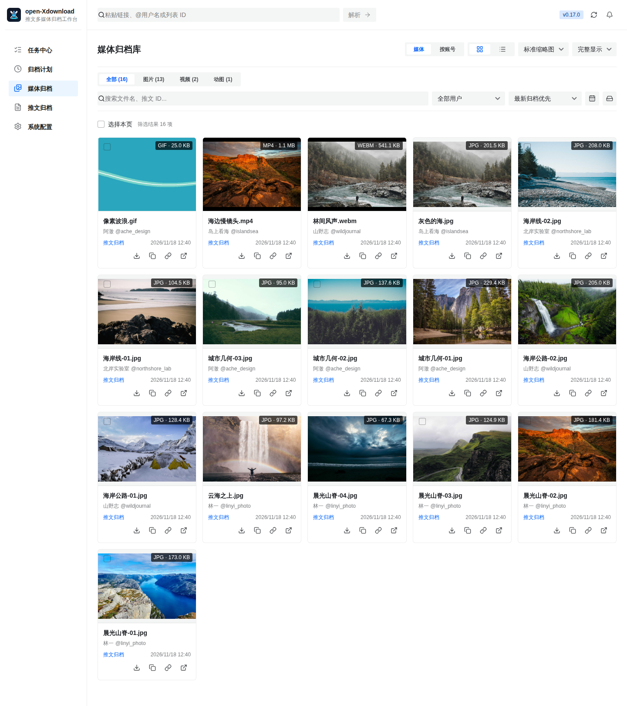
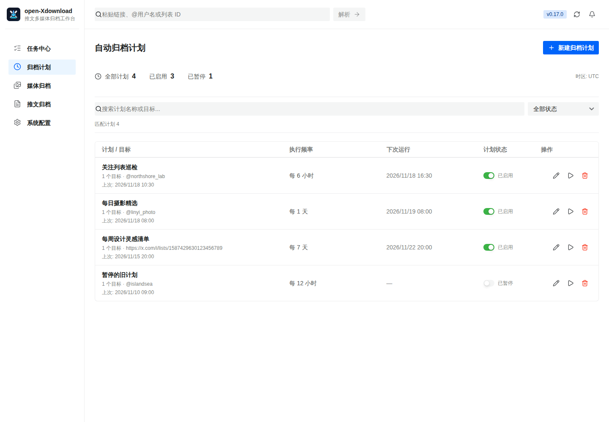
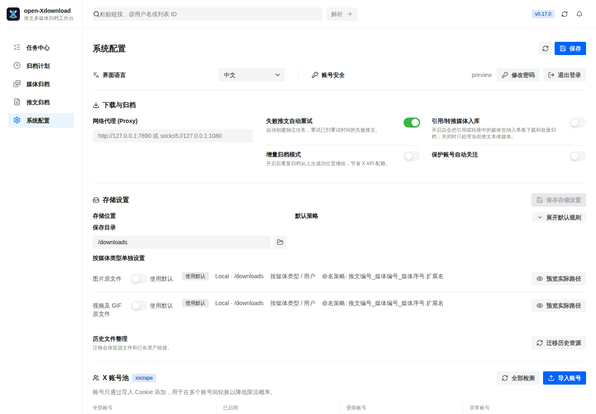
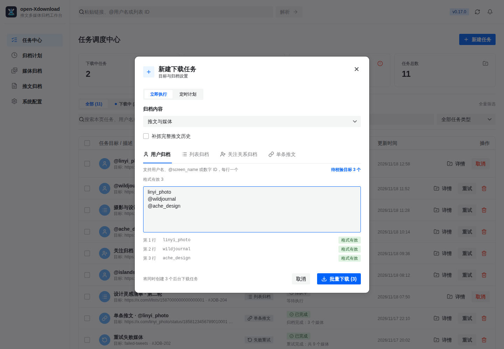

<p align="center">
  
</p>

<h1 align="center">open-Xdownload</h1>

<p align="center">
  把 X（Twitter）上的推文、图片和视频，完整归档到自己的硬盘。<br>
  本地优先 · 后台任务队列 · 定时自动归档 · 内置 Web 界面
</p>

<p align="center">
  <a href="LICENSE"></a>
  <a href="https://github.com/chenbin3625/open-Xdownload/releases"></a>
  <a href="https://github.com/chenbin3625/open-Xdownload/actions/workflows/ci.yml"></a>
  <a href="https://hub.docker.com/r/chenbin3625/open-xdownload"></a>
</p>

---

open-Xdownload 是一个本地优先的 X / Twitter 媒体下载与归档工具。它提供简洁的 Web 界面，可以把单条推文、某个用户、某个列表或关注关系中的媒体批量保存到本地；任务在后台排队执行，支持定时归档、跳过已下载内容、失败重试，下载完成后还能像刷 X 一样浏览归档内容。

所有数据都保存在你自己的机器上，不依赖任何第三方网盘或在线服务。

## 目录

- [功能亮点](#功能亮点)
- [界面预览](#界面预览)
- [快速开始](#快速开始)
- [首次配置](#首次配置)
- [使用教程](#使用教程)
- [媒体存储与备份](#媒体存储与备份)
- [常见问题](#常见问题)
- [安全与合规](#安全与合规)
- [从源码运行](#从源码运行)
- [许可证](#许可证)

## 功能亮点

- **单条推文下载**：粘贴 `x.com` 或 `twitter.com` 推文链接，解析正文、作者和媒体列表，下载图片、视频、GIF 的最佳可用版本。
- **用户媒体归档**：输入用户名、`@用户名` 或用户 ID，归档该用户媒体时间线中的全部媒体。
- **列表归档**：输入 X 列表 ID 或列表链接，自动获取列表成员并归档成员发布的媒体。
- **关注关系归档**：输入一个账号，归档它关注的账号所发布的媒体。
- **批量任务**：用户、列表、关注目标可以一次粘贴多行，单次最多创建 200 个任务，并自动去重。
- **定时自动归档**：把归档目标保存为计划，按分钟、小时或天自动运行，支持启用、暂停、立即运行和删除。
- **智能跳过重复内容**：转推、引用和卡片媒体指向同一份内容时自动识别；已下载且文件仍在的媒体不会重复下载。
- **失败重试**：失败的推文会进入失败队列，可以手动重试，也可以开启任务结束后的自动重试。
- **推文归档阅读**：保留推文正文、作者、时间、引用和转推关系，以及图片、视频网格，断网也能回看。
- **媒体归档库**：按图片、视频、GIF 分类浏览，支持按用户筛选、按文件名 / 媒体地址 / 推文 ID 搜索，以及大图预览和键盘切换。
- **多账号 Cookie 池**：导入多个 X 账号，批量归档时自动轮换，降低限流影响；失效账号会自动停用。
- **本地存储**：媒体按类型和用户名整理在本地目录，方便备份、迁移或交给其他工具继续处理。
- **中文 / English 界面**：在「系统配置」中切换；默认跟随浏览器语言。

## 界面预览

> 以下截图使用演示数据生成，不包含真实账号、Cookie、下载路径或任务记录。

### 任务中心

所有下载和归档任务都在这里排队、执行和汇总。可以看到实时进度、完成数量、异常任务，并直接取消、重试或查看详情。



### 推文归档

归档下来的推文会保留正文、作者、发布时间、引用关系和媒体网格，支持紧凑 / 舒适两种阅读布局。



### 媒体归档库

图片、视频和 GIF 统一管理，支持按用户筛选、搜索、预览和批量操作。



### 归档计划

把常用的归档目标保存为计划，按固定间隔自动执行。



## 快速开始

### 方式一：Docker Compose（推荐）

新建一个目录，并在其中创建 `compose.yml`：

```yaml
services:
  open-xdownload:
    image: chenbin3625/open-xdownload:latest
    container_name: open-xdownload
    restart: unless-stopped
    ports:
      - "8787:8787"
    environment:
      OPEN_XDOWNLOAD_ADDR: 0.0.0.0:8787
      OPEN_XDOWNLOAD_DATA_DIR: /data
      OPEN_XDOWNLOAD_DOWNLOAD_DIR: /downloads
      TZ: Asia/Shanghai
      PUID: ${PUID:-1000}
      PGID: ${PGID:-1000}
    volumes:
      - ./data:/data
      - ./downloads:/downloads
```

启动：

```bash
docker compose up -d
```

然后在浏览器打开：

```text
http://127.0.0.1:8787
```

如果部署在 NAS 或服务器上，把 `127.0.0.1` 换成机器的局域网 IP 即可。

升级：

```bash
docker compose pull
docker compose up -d
```

停止：

```bash
docker compose down
```

> **首次使用请先创建本地账号，再对外开放访问。** 如果只想从本机访问，把端口映射改为 `127.0.0.1:8787:8787`；如果要暴露到公网，请先配置 HTTPS 和访问控制。

Linux 宿主机建议让 `PUID` / `PGID` 与当前用户一致，避免下载目录里的文件变成无法读写的容器用户文件。默认是 `1000:1000`，如果不同，可以在同目录创建 `.env`：

```env
PUID=1000
PGID=1000
```

<details>
<summary>也可以直接使用 docker run</summary>

```bash
docker run -d \
  --name open-xdownload \
  --restart unless-stopped \
  -p 8787:8787 \
  -e OPEN_XDOWNLOAD_ADDR=0.0.0.0:8787 \
  -e OPEN_XDOWNLOAD_DATA_DIR=/data \
  -e OPEN_XDOWNLOAD_DOWNLOAD_DIR=/downloads \
  -e TZ=Asia/Shanghai \
  -e PUID="$(id -u)" \
  -e PGID="$(id -g)" \
  -v "$PWD/data:/data" \
  -v "$PWD/downloads:/downloads" \
  chenbin3625/open-xdownload:latest
```

</details>

### 方式二：下载二进制运行

从 [Releases](https://github.com/chenbin3625/open-Xdownload/releases) 下载对应系统的 `open-xdownload`，赋予执行权限后直接运行：

```bash
chmod +x open-xdownload
./open-xdownload
```

默认监听 `127.0.0.1:8787`，只允许本机访问；数据保存在当前目录的 `data/`，下载文件保存在当前目录的 `downloads/`。

需要局域网访问时：

```bash
./open-xdownload -addr 0.0.0.0:8787
```

也可以用环境变量指定路径：

```bash
OPEN_XDOWNLOAD_DATA_DIR=/path/to/data \
OPEN_XDOWNLOAD_DOWNLOAD_DIR=/path/to/downloads \
./open-xdownload -addr 0.0.0.0:8787
```

常用环境变量：

| 环境变量 | 默认值 | 说明 |
| --- | --- | --- |
| `OPEN_XDOWNLOAD_ADDR` | `127.0.0.1:8787` | HTTP 监听地址。局域网访问设为 `0.0.0.0:8787`。 |
| `OPEN_XDOWNLOAD_DATA_DIR` | `data` | 数据库目录，保存配置、任务和归档记录。 |
| `OPEN_XDOWNLOAD_DOWNLOAD_DIR` | `downloads` | 媒体下载目录。Docker 镜像中默认为 `/downloads`。 |
| `OPEN_XDOWNLOAD_PROXY_URL` | 空 | 代理地址；设置后优先于 Web 界面中的代理配置。 |

## 首次配置

第一次打开 Web 界面会要求创建一个本地账号（至少 8 位密码）。这个账号只用于保护你自己的实例，不是 X 账号。

登录后进入「系统配置」，建议依次完成：

1. **下载目录**：Docker 部署由 `OPEN_XDOWNLOAD_DOWNLOAD_DIR` 固定为 `/downloads`，对应宿主机 `./downloads`；二进制运行时可以自由选择可写目录。
2. **网络代理**：如果访问 X 或下载媒体需要代理，填写类似 `http://127.0.0.1:7890` 的地址；能直连则留空。
3. **X 账号池**：用户、列表、关注归档需要登录态 Cookie。点击「导入账号」，粘贴 `auth_token` 和 `ct0`，保存后点击「检测」确认账号可用。
4. **失败推文自动重试**：按需开启。开启后，批量归档结束时会自动重试失败队列。



### 为什么需要 X Cookie？

- **单条推文**通常不需要 Cookie，公开推文可以直接解析。
- **用户、列表、关注关系归档**需要调用 X 的登录态接口，必须提供 Cookie。
- 归档量较大时，建议在账号池中导入多个账号，系统会轮换使用以降低限流概率。

<details>
<summary>如何从浏览器获取 auth_token 和 ct0</summary>

1. 在桌面浏览器中登录 `https://x.com`。建议使用独立的浏览器配置或无痕窗口，避免影响日常登录。
2. 打开开发者工具：`F12`，macOS 也可以按 `Cmd+Option+I`。
3. 打开「应用」面板（Firefox 为「存储」），在左侧展开「Cookies」，选择 `https://x.com`。
4. 复制 `auth_token` 一行的 **Value**，再复制 `ct0` 一行的 **Value**。
5. 回到「系统配置 > X 账号池」，点击「导入账号」，每行一个账号，例如：

   ```text
   auth_token=...; ct0=...
   ```

   也可以直接粘贴浏览器里完整的 `Cookie` 请求头。
6. 保存后点击「检测」。有效账号会显示对应的 `@用户名`。

注意事项：

- `auth_token` 是 `HttpOnly` Cookie，在浏览器控制台执行 `document.cookie` 看不到，需要从开发者工具的 Cookies 面板复制。
- 两个值必须来自同一个浏览器、同一个账号；不匹配时 X 会拒绝请求。
- 退出登录、修改密码或 X 主动失效会话后，Cookie 会失效，按同样步骤重新复制即可。
- Cookie 等同于账号密码。它只保存在你的本地数据库中，界面上会脱敏显示，请不要分享或粘贴到其他网站。

</details>

## 使用教程

### 下载单条推文

1. 在顶部输入框粘贴推文链接并按回车，或点击「新建任务」后切换到「单条推文」。
2. 点击「解析推文」，确认正文、作者和媒体列表。
3. 点击「立即下载入库」创建任务。
4. 在「任务中心」查看进度，完成后展开任务即可查看文件路径。

私密、删除、受限或无法公开访问的推文可能解析失败，此时需要在账号池中导入有权限查看该推文的账号。

### 批量归档用户、列表或关注关系

1. 点击右上角「新建任务」。
2. 在「用户归档」「列表归档」「关注关系归档」中选择一种类型。
3. 每行输入一个目标：
   - 用户：`openai`、`@openai` 或用户 ID；
   - 列表：列表 ID 或列表链接；
   - 关注关系：一个账号，表示归档它关注的账号所发布的媒体。
4. 在「归档内容」中选择「推文与媒体」或「仅媒体」；需要补抓更早的历史时，可以勾选「补抓完整推文历史」。
5. 确认右侧 / 下方的目标校验结果，点击「批量下载」。



单次最多 200 个目标，重复目标会自动去重。任务会进入后台队列，可以随时回到「任务中心」查看进度或取消。

### 创建定时归档计划

1. 在「新建任务」中填写目标和归档内容。
2. 切换执行方式为「定时计划」，填写计划名称和执行间隔。
3. 点击保存。

执行间隔范围为 5 分钟到 43200 分钟（30 天），每个计划最多 200 个目标。如果上一次计划创建的任务还在运行，下一次执行会自动顺延。

在「归档计划」页面可以查看所有计划，并进行启用、暂停、立即运行或删除。

### 浏览推文归档

打开「推文归档」可以像阅读时间线一样查看已归档的推文：

- 支持「紧凑」和「舒适」两种布局；
- 可以按作者、媒体类型、发布时间筛选，也可以搜索正文；
- 支持隐藏转推或只看转推；
- 点击媒体可以放大预览，视频会直接播放；
- 在详情中可以查看来源任务、复制文件路径或定位到媒体库。

### 浏览媒体归档库

打开「媒体归档」：

- 顶部标签按「全部 / 图片 / 视频 / 动图」筛选，括号内是数量；
- 可以按用户筛选，或搜索文件名、媒体地址和推文 ID；
- 支持按归档时间、文件体积排序；
- 点击图片或视频缩略图打开预览，使用左右方向键切换相邻文件；
- 每张卡片都提供下载、复制路径、复制链接和打开原文件等操作。

### 处理失败任务

- 运行中的任务可以点击「取消」。
- 失败、取消、完成或部分失败的任务可以点击「重试」，系统会新建任务并保留原任务记录。
- 只要归档任务中有媒体下载失败，状态会标记为「部分失败」，不会和完全成功的任务混在一起。
- 批量归档中的可重试推文会进入失败队列，点击「查看失败项」可以全部重试、删除单条或清空队列。
- 开启「失败推文自动重试」后，任务结束时会自动处理失败队列。

## 媒体存储与备份

默认按媒体类型和用户名分类存放：

```text
downloads/
  image/
    用户名/
      图片原文件
  video/
    用户名/
      视频和 GIF 原文件
```

说明：

- 图片尽量下载大图版本，视频和 GIF 选择最高码率版本。
- 文件名会自动清理系统不支持的字符，并受「最大文件名长度」限制。
- 已保存的存储策略和历史文件会保留原位置；可以在「系统配置 > 存储设置」中调整策略，并使用「迁移历史资源」整理旧文件。

建议定期备份以下内容：

```text
data/open-xdownload.db    # 配置、任务、归档记录、Cookie 等
downloads/                # 实际媒体文件
```

Docker 部署对应宿主机的 `./data` 和 `./downloads` 两个目录。备份数据库前最好先停止服务，或使用 SQLite 的在线备份方式，避免复制到写入中的数据库。

## 常见问题

### 单条推文也需要 Cookie 吗？

通常不需要。只有推文本身不可公开访问（私密、受限、已删除等）时才需要提供有权限的账号。

### 任务失败或提示限流怎么办？

1. 在「系统配置 > X 账号池」点击「检测」，确认账号仍然有效。
2. 如果只有一个账号，可以再导入几个账号，让系统自动轮换。
3. 检查代理是否可用，或稍后重试。
4. 失败队列中的推文可以单独重试，不必重新跑整个任务。

### 为什么下载速度变慢了？

X 会对登录态接口限流。归档量较大时，请给账号池补充更多账号，并避免同时运行过多大任务。任务队列默认串行执行，这是为了降低触发限流的概率。

### 下载目录里的文件属主不对 / 无法删除？

Docker 部署时设置 `PUID` 和 `PGID` 为宿主机当前用户的 UID / GID，然后重新启动容器。历史文件可能需要手动 `chown` 一次，或临时设置 `OPEN_XDOWNLOAD_FORCE_CHOWN=1` 启动。

### 可以在局域网或公网访问吗？

可以。二进制运行使用 `-addr 0.0.0.0:8787`；Docker 使用端口映射 `8787:8787`。公网访问请务必配置 HTTPS、强密码和防火墙，建议放在反向代理之后。

### 支持多用户吗？

当前版本是单实例、单本地账号设计，适合个人或家庭自用。多人使用建议各自部署独立实例。

### 升级会丢失数据吗？

不会。`data/` 中的数据库和 `downloads/` 中的文件会保留。升级后如果要求重新登录，使用原来的本地账号密码即可。

### 截图里的账号和数据是真实的吗？

不是。文档截图全部使用演示数据生成，不包含真实账号、Cookie、下载路径或任务记录。

## 安全与合规

- 本工具使用单个本地账号保护 Web 界面。请先完成账号创建，再把服务开放到局域网或公网。
- 默认只监听 `127.0.0.1:8787`。远程访问请使用 HTTPS，并配合反向代理、访问控制和防火墙。
- X Cookie 等同于账号密码，只保存在本地数据库中；界面上会脱敏显示，但仍请妥善保护 `data/` 目录。
- 请确认你有权下载和保存相关内容，并遵守 X / Twitter 的服务条款、目标站点的规则以及所在地法律法规。
- 本项目仅用于个人备份和归档，请勿用于侵犯版权、隐私或其他违法用途。

## 从源码运行

需要 Go 1.26+ 和 Node.js 22+：

```bash
npm --prefix apps/web install
npm run build:embedded
go run ./cmd/server
```

开发模式：

```bash
npm run dev          # 前端 Vite 开发服务器
go run ./cmd/server  # 后端，默认 127.0.0.1:8787
```

运行测试：

```bash
go test ./...
npm --prefix apps/web run test
```

## 许可证

本项目以 [MIT License](LICENSE) 授权。

---

如果这个项目对你有帮助，欢迎点一个 Star ⭐
