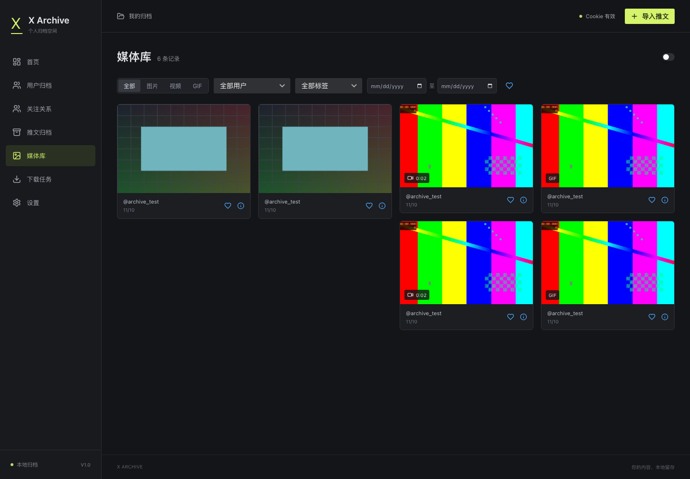

# X Archive

将 X / Twitter 推文、原始图片、视频、GIF 和关注关系保存在自己的设备上。通过浏览器管理归档，使用自己的 X 登录会话，无需申请 X API Key。

本项目由 open-Xdownload 演进而来，当前主分支为 Rust 版本 X Archive。原 Go 版本及归档时的本地修改保留在 [`archive/open-Xdownload`](https://github.com/chenbin3625/x-archive/tree/archive/open-Xdownload) 分支，两个项目的提交历史和原有版本标签均保留。

[下载二进制](https://github.com/chenbin3625/x-archive/releases) · [Docker Hub 镜像](https://hub.docker.com/r/chenbin3625/x-archive) · [更新记录](CHANGELOG.md) · [MIT License](LICENSE)

## 功能

- **用户归档**：添加用户名或主页链接，保存可访问的本人推文与回复；支持定时增量同步、立即同步、暂停和去重。
- **单条导入**：粘贴 X / Twitter 推文链接，保存正文和媒体；纯文字推文同样入库。
- **本地媒体库**：原图缩放、视频和 GIF 播放，按用户、日期、类型、收藏和标签筛选，随时返回原推文。
- **分类存储**：原始媒体、缩略图和视频封面的根目录与路径模板均可配置，支持按作者用户名、媒体类型等自由组织，也可保存到数据目录之外的绝对路径。
- **关注关系**：手动或定时保存 Following / Followers 快照，浏览历史，比较完整快照的新增和取消关系。
- **任务管理**：按导入或用户同步汇总媒体下载数量、大小与失败原因，支持取消、重试、下载并发和重启后继续处理。
- **批量与成员归档**：每次最多提交 200 个目标，自动去重；支持用户、推文链接、X List ID / 链接，以及某用户关注的所有人（Following）。列表和关注归档会展开成员，再创建用户同步任务。
- **计划任务**：创建、编辑、启用 / 禁用、立即运行和删除定时计划；每个计划最多 200 个目标，支持混合任务类型，间隔为 5 至 43200 分钟。
- **Cookie 池与代理**：主 Cookie 加最多 20 组备用 Cookie，可为备用凭据分配任务类型；按类型轮换，遇到限流或会话失效自动冷却。支持 HTTP、HTTPS、SOCKS5 / SOCKS5h 全局代理。
- **失败推文队列**：推文提取和媒体下载失败后独立记录，指数退避重试；任务页抽屉可查看错误、下次重试时间、立即重试或移除已结束的失败项，成功后自动出队。
- **独立部署**：一个 Rust 服务提供 Web 界面和 API，SQLite 存储；Docker 镜像包含全部下载工具，无需外部数据库或 Redis。



归档范围取决于当前账号权限和 X 实际返回的内容，不保证获取全部历史。部分关系快照可查看成员，但不用于推断取关。

## Docker Compose 部署

推荐使用 Docker Engine 和 Compose，镜像为 `chenbin3625/x-archive`，支持 `linux/amd64`、`linux/arm64`。无需安装 Rust、Node.js、Python 或 FFmpeg。

```sh
mkdir x-archive
cd x-archive
curl -fsSLO https://raw.githubusercontent.com/chenbin3625/x-archive/main/compose.yaml
```

编辑 `compose.yaml`，将 `command` 中 `--password` 后的空字符串改为自己的访问密码。镜像、端口、密码和目录均直接在此文件中配置，无需 `.env`。

主分支 Compose 默认使用 `edge` 镜像。稳定版 `1.3.0` / `latest` 同样使用启动参数配置，可直接使用此文件；更早的 `1.2.0` 使用旧的环境变量配置方式，不能直接套用此配置。密码中包含 `$` 时，在 Compose 文件中写为 `$$`。然后启动：

```sh
docker compose pull
docker compose up -d
docker compose logs -f x-archive
```

打开 `http://服务器IP:3000`，使用访问密码登录。默认发布到 `0.0.0.0:3000`，远程访问建议配置 [HTTPS 反向代理或 SSH 隧道](docs/OPERATIONS.md#远程访问)。

默认 [compose.yaml](compose.yaml) 使用两个命名卷保存数据和配置。需要直接挂载宿主机目录时，参考 [绑定目录示例](examples/compose.bind.yaml)；已有目录和内容需允许 UID/GID `10001` 读写。

存储目录不要求使用 `/data`。示例使用容器内的 `/app/data` 和 `/app/config`，可同时修改 `--data-dir`、`--config-dir` 及 `volumes` 中对应的容器路径；绑定目录示例中冒号左侧的 `./data`、`./config` 也可改为自己的宿主机目录。

镜像标签：`latest` 为最近稳定版，`1.3.0` 为指定版本，`1.3` / `1` 跟随对应版本系列，`edge` 跟随 `main`。主分支配置使用：

```yaml
image: chenbin3625/x-archive:edge
```

固定版本时应使用与该版本兼容的部署配置。`1.3.0` 及主分支镜像使用启动参数和 `/app/data`、`/app/config`；`1.2.0` 镜像通过 `X_ARCHIVE_PASSWORD`、`X_ARCHIVE_DATA` 和 `X_ARCHIVE_CONFIG` 等环境变量配置，默认持久化路径为 `/data`、`/config`。已有命名卷可保持卷名，仅调整容器挂载路径；绑定目录部署应保留原宿主机目录。

更新时，先备份数据和配置；若固定版本，先修改镜像标签及对应配置，再运行：

```sh
docker compose pull
docker compose up -d
```

`docker compose down` 保留数据；**`docker compose down -v` 会删除数据卷**。

### 从源码构建镜像

在仓库根目录填写 `compose.yaml` 中的访问密码后运行：

```sh
docker compose -f compose.yaml -f compose.build.yaml up -d --build
```

[compose.build.yaml](compose.build.yaml) 使用本地源码构建，不需要先拉取发布镜像。双架构构建见 [开发文档](docs/DEVELOPMENT.md#docker-构建)。

## 二进制部署

在 [Releases](https://github.com/chenbin3625/x-archive/releases) 下载对应平台的压缩包，并用同页的 `SHA256SUMS` 校验。包名为 `x-archive-v<版本>-<目标平台>.tar.gz`，Windows 使用 `.zip`。

| 平台 | 目标平台 |
| --- | --- |
| Linux x86-64 | `x86_64-unknown-linux-musl` |
| Linux ARM64 | `aarch64-unknown-linux-musl` |
| macOS Intel | `x86_64-apple-darwin` |
| macOS Apple Silicon | `aarch64-apple-darwin` |
| Windows x86-64 | `x86_64-pc-windows-msvc` |

前端已嵌入二进制，运行无需 Rust 或 Node.js。下载功能需要 **Python 3.9+、gallery-dl、yt-dlp、FFmpeg 和 FFprobe**；FFmpeg/FFprobe 需安装到 PATH，Python 工具版本见包内 `requirements-tools.txt`。

### Linux / macOS

安装 Python 和 FFmpeg，解压并进入发布包目录后：

```sh
python3 -m venv .tools
.tools/bin/pip install -r requirements-tools.txt
chmod +x x-archive
PATH="$PWD/.tools/bin:$PATH" ./x-archive
```

### Windows（PowerShell）

安装 Python 和 FFmpeg，解压并进入发布包目录后：

```powershell
py -3 -m venv .tools
.\.tools\Scripts\python.exe -m pip install -r requirements-tools.txt
$env:PATH = "$PWD\.tools\Scripts;$env:PATH"
.\x-archive.exe
```

两种方式默认均在 <http://127.0.0.1:3000> 提供服务，数据和配置保存在当前工作目录的 `data/`、`config/`。直接启动二进制**不会自动读取 `.env`**，可通过 shell、服务管理器及系统配置传入环境变量。当前发布版及主分支构建还支持以下启动参数，更早的 `1.2.0` 二进制仍使用环境变量。长期运行示例见 [运维文档](docs/OPERATIONS.md#长期运行二进制)。

当前二进制的远程部署示例：

```sh
./x-archive --bind 0.0.0.0:3000 --password 'replace-with-your-own-password' --data-dir ./data --config-dir ./config
```

## 首次使用

1. **设置 X Cookie**：在浏览器登录自己的 X 账号。开发者工具中打开 Chrome / Edge 的 **Application → Storage → Cookies → https://x.com**，或 Firefox 的 **Storage → Cookies → https://x.com**，复制同一会话中 `auth_token` 和 `ct0` 的 **Value**。
2. **保存并检测**：进入“设置 → X 登录 Cookie”，分别粘贴到同名输入框，只填值，无需名称前缀或整个 Cookie 请求头。点击“保存并检测”，等待任务确认会话有效。保存后输入框清空，已存值不会回显。
3. **开始归档**：在“用户归档”添加用户名、`@用户名` 或主页链接；也可以使用“导入推文”粘贴单条链接。开启自动下载后，媒体会进入下载队列。
4. **浏览媒体**：在“媒体库”筛选用户、日期和类型，查看原图或播放视频，添加收藏与标签；失败任务可在任务页查看原因并重试。
5. **保存关系快照**：在“关注关系”选择用户和 Following / Followers，手动抓取或在设置中启用定时快照。只有同一用户、同一方向的两份完整快照可比较。

Cookie 格式通过校验不等于登录会话有效。过期时重新复制、保存并检测；删除主 Cookie 且没有已启用的备用 Cookie 时会取消未结束任务，已归档内容保留。只归档自己有权访问的内容。

用户首次同步会读取当前会话可访问的历史，完整成功后才记录增量同步游标，后续同步保留两天重叠范围。单条导入和部分失败结果不会推进游标。已有数据库升级到独立同步游标后，每个用户会重新完成一次历史读取，以补齐旧增量边界可能遗漏的内容；已归档推文和媒体会去重。

“批量归档”可选择列表归档或关注者归档。关注者归档指目标用户的 **Following（其关注的人）**，不代表 Followers（关注该用户的人）。每行一个目标，提交前整体校验，重复目标及正在执行的同类型目标会合并。混合模式可识别用户、推文链接和列表，也可用 `following username` 显式指定关注归档。

成员同步会作为独立任务出现在任务页。取消列表 / 关注展开任务会停止后续成员入队，已创建的用户同步任务可分别取消；归档过的成员会保留在“用户归档”中，按该页面的启用状态和同步间隔持续同步。

“计划任务”按固定分钟间隔运行，首次创建或编辑后从当前时间重新计时，立即运行也会重新计时；禁用不会取消已经入队的任务。服务每 30 秒检查到期计划，重启后会补触发一次到期计划，不逐次补跑停机期间的所有周期。

在“设置”中添加备用 Cookie 并选择适用的任务类型；凭据不会回显。限流会冷却该凭据 15 分钟，会话失效冷却 1 小时；冷却状态仅保存在当前进程中。失败任务普通退避为 30 秒、60 秒，限流退避为 15 分钟、30 分钟，上限 1 小时，默认每轮最多尝试 3 次；所有可用凭据冷却时等待不会消耗尝试次数。手动重试开启新一轮尝试。代理设置保存后对后续网络操作生效；留空使用运行环境默认网络配置，带认证的代理地址会脱敏显示。

## 数据与配置

```text
data/
  images/<username>/      默认图片与原生 GIF（根目录和模板可配置）
  videos/<username>/      默认视频与 MP4 GIF（根目录和模板可配置）
  thumbnails/<username>/  默认缩略图与视频封面（根目录和模板可配置）
config/
  archive.sqlite          推文、媒体索引、任务、快照、收藏与标签
  .instance.lock          实例锁
  settings.json           Web 设置
  cookies.txt             私有 X 会话
  cookie-pool.json        私有备用会话及任务类型配置
```

Compose 示例中对应 `/app/data`、`/app/config`，实际位置由启动参数及卷挂载决定。图片、视频和缩略图分别有根目录与路径模板：根目录相对数据目录解析，也可填写绝对路径或 `{data}/...`；模板支持 `{data}`、`{kind}`、`{author}`、`{tweet_id}`、`{ordinal}`、`{extension}`、`{media_id}` 占位符，模板为绝对路径或包含 `{data}` 时忽略根目录。默认模板为 `{author}/{tweet_id}_{ordinal}.{extension}`（缩略图为 `{author}/{media_id}.{extension}`），按小写用户名分目录。修改根目录或模板只影响后续下载，不迁移旧文件，旧媒体仍按数据库记录的原路径读取。每个配置目录只能运行一个实例，不同实例应使用独立的媒体目录。备份时先停止服务，再备份完整数据目录、配置目录以及自定义的媒体根目录。

从旧版本升级时，先停止旧实例并备份两个目录。启动时若仅数据目录中存在 `archive.sqlite`，会自动将数据库（包含 WAL 中已提交的数据）迁移到配置目录，成功后清理旧数据库及其 WAL/SHM 文件，媒体文件及记录路径保持原样；配置目录需有足够空间保存数据库副本。若两个目录均有数据库，服务会停止并提示人工确认，避免覆盖已有数据。迁移后不要直接使用旧版本启动。

启动参数 `--bind`、`--password`、`--data-dir`、`--config-dir` 分别设置监听地址、访问密码、数据目录和配置目录，优先于对应环境变量。Compose 使用这些参数；二进制部署也可使用以下环境变量：

| 环境变量 | 默认值 | 用途 |
| --- | --- | --- |
| `X_ARCHIVE_BIND` | `127.0.0.1:3000` | 监听地址；镜像默认启动命令使用 `--bind 0.0.0.0:3000` |
| `X_ARCHIVE_PASSWORD` | 无 | Web 访问密码；对外监听时必填 |
| `X_ARCHIVE_DATA` | `data` | 媒体目录；相对路径基于工作目录，镜像工作目录为 `/app` |
| `X_ARCHIVE_CONFIG` | `config` | 配置与数据库目录；相对路径基于工作目录，镜像工作目录为 `/app` |
| `GALLERY_DL_BIN` | `gallery-dl` | gallery-dl 可执行文件路径 |
| `YT_DLP_BIN` | `yt-dlp` | yt-dlp 可执行文件路径 |
| `RUST_LOG` | `x_archive=info,tower_http=warn` | 日志级别 |

Compose 的镜像和发布地址直接修改 `image`、`ports`；仅供本机反向代理使用时，可将 `ports` 改为 `127.0.0.1:3000:3000`。

## 常见问题

| 问题 | 处理 |
| --- | --- |
| Cookie 无效或内容无权访问 | 浏览器确认能访问目标，更新同一会话的两个 Cookie 后重新检测 |
| 遇到 X 限流 | 等待任务中的重试时间，延长同步间隔 |
| 下载或媒体处理失败 | 设置页检查四项工具、网络和存储空间；X 接口变化时可能需要更新下载工具 |
| 关系快照为“部分” | X 返回数量可能不完整或抓取期间发生变化；部分结果不用于判断取关 |
| 重启后需要登录 | Web 登录会话随进程重置；X Cookie、设置和归档仍持久保存 |

更多说明：[会话、归档边界与运维](docs/OPERATIONS.md) · [源码开发、测试与发布](docs/DEVELOPMENT.md) · [验证记录](docs/VERIFICATION.md)。
